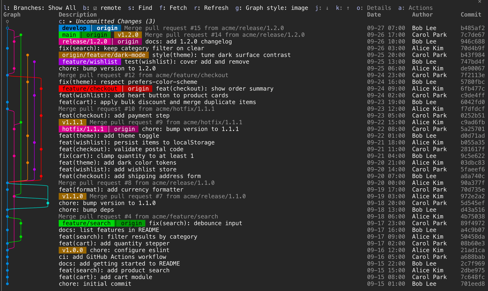
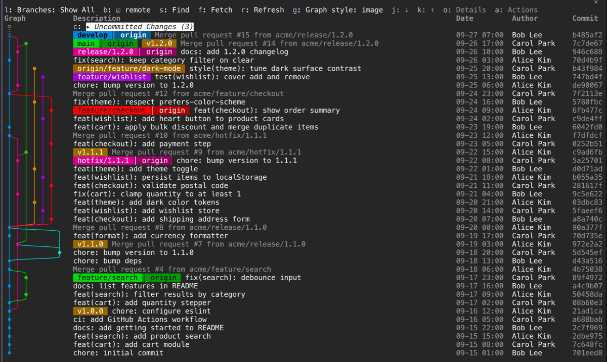
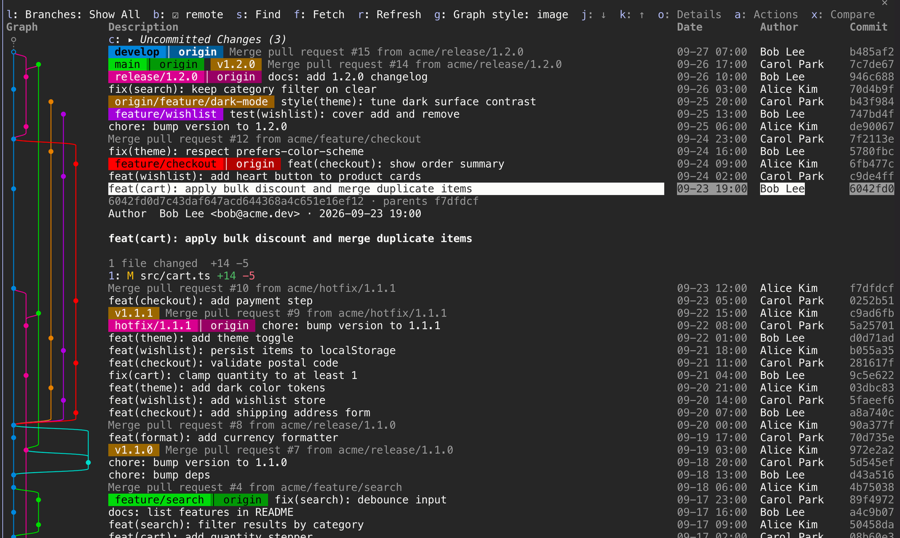
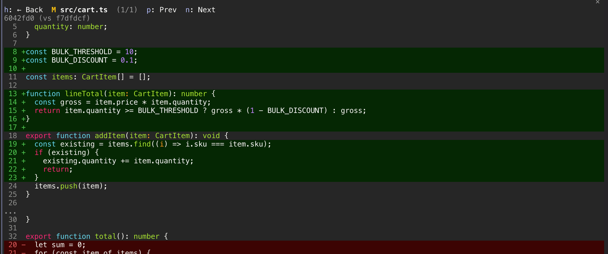
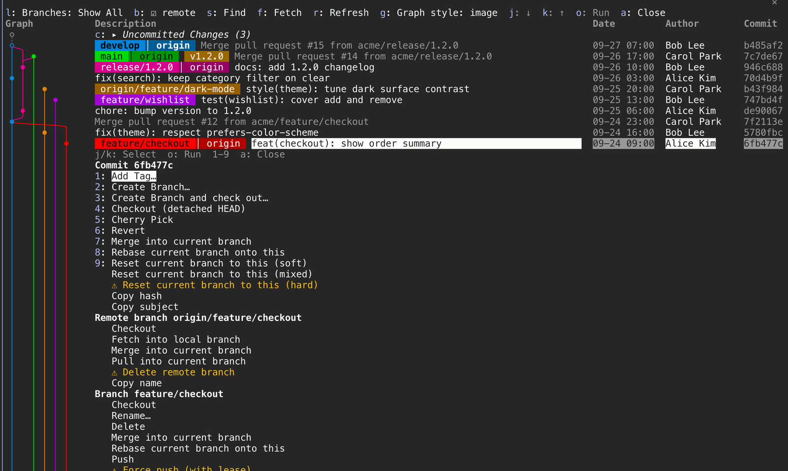

English | [한국어](README.ko.md)

# git-graph-panel

A Claude Code mod that puts a [Git Graph](https://marketplace.visualstudio.com/items?itemName=mhutchie.git-graph)-style commit graph in a terminal pane next to your session. Browse history, read diffs, and run common git actions without leaving Claude Code.





## Requirements

- Claude Code (tested on 2.1.302)
- git
- For the curved image graph: kitty, Ghostty or WezTerm. Other terminals, and anything inside tmux, get a text graph automatically.
- In the desktop app the graph is always text. The mobile app has no text field, so Find and the actions that ask for a name (Add Tag, Create Branch, Rename, Stash) are not offered there.

## Install

At the prompt of a Claude Code terminal session:

```
/plugin install git-graph-panel --marketplace tunggary/git-graph-panel
```

From a shell:

```
claude plugin install git-graph-panel --marketplace tunggary/git-graph-panel
```

In the desktop app: click **+**, choose **Plugins**, then **Add marketplace**, enter `tunggary/git-graph-panel`, and install `git-graph-panel` from it.

While installing, Claude Code asks whether to add the marketplace (answer `y`) and which scope to use (user scope loads the plugin in every session).

## Quick start

1. Run `claude` inside a git repository.
2. The pane opens by itself. If it did not, run `/graph`. Run `/graph` again to close it.
3. Press `ctrl+x tab` to move keyboard focus to the pane.
4. Press `j` / `k` to move the cursor between commits, and `o` to open the details of the commit under the cursor.
5. Press `a` to open the action menu for the row (checkout, cherry-pick, tag, and more).

## Features

### Toolbar

The top of the pane is a row of buttons, each written as key and label: `l: Branches: develop`, `b: ☑ remote`, `s: Find`, `f: Fetch`, `r: Refresh`, `g: Graph style: image`, then `j: ↓`, `k: ↑`, `o: Details` and `a: Actions`. A button does the same as its key, so everything below works with the mouse too.

- Labels follow what is open: with the Branches list open, `o` reads `Pick`; with the action menu open, `o` reads `Run` and `a` reads `Close`.
- `x: Compare` appears only while a commit's details are open, and `n: Next` / `p: Prev` only while a Find has matches.
- In a pane narrower than 100 columns the buttons wrap onto more lines and the style button reads just `image` or `text`.

### Graph

- **Rows**: one per commit of `git log --branches --remotes --tags HEAD --date-order`, under a header `Graph  Description  Date  Author  Commit`. The first page is 50 commits; **Load more** (`m`) adds 50 each time. A repository without commits shows `No commits yet.`
- **Two styles**: `image` draws each row as a small PNG (straight lines, smooth curves, filled nodes, an open ring for the checked-out commit); `text` uses box-drawing characters. Press `g` to switch; the choice is remembered. The default is `image` on kitty, Ghostty and WezTerm and `text` elsewhere, always `text` inside tmux.
- **Lanes** use Git Graph's colors. As many lanes are drawn as fit in 40% of the pane width (two cells per lane, at least 8). Further lanes fold into a `…` at the right edge.
- **Labels** are colored pills in the lane color of their commit. A remote-only branch (`origin/x`) is a darker tone, tags are amber, a detached `HEAD` is purple, and the checked-out branch is bold. A local branch that a remote also has is one pill: `develop │ origin`.
- **Merge commits** have a dimmed description.
- **Columns** are graph, labels and message, date (`10-18 16:25`, local time), author and short hash. In a narrow pane the hash is hidden first, then the author, then the date.
- **Uncommitted Changes (n)** is a row on top of `HEAD`, hidden when the working tree is clean. Press it (or `c`) to unfold the files with their status (`M` `A` `D` `R` `??`). Press a file (or `1`-`9` for the first nine, while no details or menu is open) to see its diff, `HEAD` ↔ working tree; `n` / `p` then walk the uncommitted files. Untracked files are diffed against an empty file.
- **Remote toggle** `☑ remote` (`b`) is on by default. Off, the graph and the Branches list show local branches only. If a remote branch was picked in Branches, the filter goes back to `Show All`.
- **Stashes** and other tools' private refs (such as `refs/cmux/*`) are not shown, as in Git Graph.
- **Refresh**: the pane reloads when it opens, when you press `r`, and after every Bash tool call whose command contains `git`. There is no polling, so a change made in another terminal appears after the next refresh.

### Commit details and diff



Press `o` (or click the description) to unfold a commit under its row. One commit is open at a time.

- Full hash and parents, author with email and date, and the committer when different.
- The whole commit message.
- Changed files under a summary line such as `3 files changed  +15 -4`, each like `M src/app.ts +12 -3`, with `bin` for binary files and `R old → new` for renames. A merge is compared with its first parent and a root commit with the empty tree. Past 200 files, the rest is summed up in one line.

Press a file (click it, or press its digit `1`-`9` for the first nine) to open its diff. The diff takes over the whole pane: a bar with `h: ← Back`, the file, `(2/5)`, `p: Prev` and `n: Next`; the range (`abc1234 (vs def5678)`); a strip of files; then the colored unified diff. `n` / `p` step through the files, `h` returns to the graph with your cursor, details and Find as they were.



A diff longer than 2500 lines or 90000 characters is cut on a line and says how many lines were left out. A binary file, or a rename without edits, gets a one-line note. A refresh re-reads the open diff in place; if its file is no longer in the range, the pane returns to the graph.

### Compare

With a commit's details open, move the cursor to another commit (or to Uncommitted Changes) and press `x`. The details turn into `Comparing <older> ↔ <newer>` with the files that differ (`git diff -M older newer`). Against Uncommitted Changes, the working tree is the newer end and untracked files are listed as added. Press a file to see its diff between the same two points. `x` on another row changes the target; `x` on the open commit goes back to its details.

### Branches, Find, Fetch

- **Branches** (`l`, the button reads `Branches: <current>`) opens a list under the toolbar: `Show All` or one local or remote branch. `j` / `k` move the highlight, `o` picks it, `1`-`9` pick the first nine entries, `l` closes; an entry can also be clicked. Opening the list closes any open details, comparison or action menu. The graph then shows only the commits reachable from that branch. If the branch disappears (for example pruned by a fetch), the filter falls back to `Show All`. The Uncommitted Changes row is hidden when the chosen branch does not contain `HEAD`.
- **Find** (`s`) opens a field. As you type, matches are highlighted in the loaded commits' message, author and hash, and branch and tag names are underlined. A counter such as `3/12 matches` shows where the cursor is. Enter keeps the highlight and moves to the first match; `n` / `p` step through matches (wrapping). Empty the field or press `✕ Clear` to drop it. Only commits that are already loaded are searched.
- **Fetch** (`f`) runs `git fetch --all --prune` without asking, shows `Fetching…` in the status line, toasts the result and refreshes.

### Actions



Press `a` to open the action list under the cursor's row (the top row if there is no cursor). The list has a section for the commit and one for each label on the row. While it is open, `j` / `k` move the highlight, `o` runs it, `1`-`9` run the first nine items, and `a` closes the list. Items can also be clicked. Clicking another row closes the list.

| Target | Actions |
| --- | --- |
| Commit | Add Tag…, Create Branch…, Create Branch and check out…, Checkout (detached HEAD), Cherry Pick, Revert, Merge into current branch, Rebase current branch onto this, Reset current branch to this (soft / mixed / hard), Copy hash, Copy subject |
| Local branch | Checkout, Rename…, Delete, Merge into current branch, Rebase current branch onto this, Push, Force push (with lease), Pull, Copy name |
| Remote branch (`origin/x`) | Checkout, Fetch into local branch, Merge into current branch, Pull into current branch, Delete remote branch, Copy name |
| Tag | Push tag, Delete tag, Delete tag (also on origin), Copy name |
| Uncommitted Changes | Stash all changes…, Stash all changes, untracked included…, Discard all changes, Discard all changes and remove untracked files, Clean untracked files, and Abort merge / rebase / cherry-pick / revert while one is in progress |

Items that do not apply are left out:

- The checked-out branch has no Checkout, Delete, Merge or Rebase, and Pull appears only on it.
- `HEAD`'s own commit row has no Cherry Pick, Merge, Rebase, Reset or detached Checkout.
- A remote branch whose local name is the checked-out branch has no Checkout or Fetch into local branch.

Notes:

- Cherry Pick and Revert of a merge commit use `-m 1`.
- Remote Checkout creates a local branch that tracks it, or switches to the existing one.
- Pull is `git pull --no-rebase --no-edit`; Merge uses `--no-edit`.
- Push goes to the branch's upstream, or to a new `origin/<name>` that it then tracks.
- Copy uses the terminal's clipboard (a clipboard tool or OSC 52). If that does not work, the toast shows the value.
- While a command runs, the status line shows `Running git …`. When it ends, a toast reports the result (such as `Deleted feature/x`), the list closes and the graph refreshes.

## Keys

Keys work once the pane has keyboard focus (`ctrl+x tab`, or a click).

### Graph

| Key | Does |
| --- | --- |
| `j` / `k` | Move the cursor down / up one row. The first press lands on the top row |
| `o` | Open or close the details of the commit under the cursor. On the Uncommitted row, unfold its files |
| `a` | Open or close the action menu of the cursor's row |
| `x` | With details open, compare the open commit with the one under the cursor |
| `l` | Open or close the Branches list |
| `s` | Find |
| `n` / `p` | Next / previous match while a Find has matches |
| `f` | Fetch |
| `r` | Refresh |
| `b` | Toggle remote branches |
| `g` | Switch graph style (`image` / `text`) |
| `c` | Unfold or fold the Uncommitted Changes files |
| `m` | Load more commits |
| `1`-`9` | With details or a comparison open, open the diff of that file |

### Commit details

| Key | Does |
| --- | --- |
| `o` | Close the details |
| `x` | Compare with the commit under the cursor; on the open commit itself, back to its details |
| `1`-`9` | Open the diff of the first nine files |

### Diff view

| Key | Does |
| --- | --- |
| `h` | Back to the graph |
| `n` / `p` | Next / previous file (stops at the ends) |
| `1`-`9` | Jump to that file |

### Action menu

| Key | Does |
| --- | --- |
| `j` / `k` | Move the highlight (section titles are skipped) |
| `o` | Run the highlighted item |
| `1`-`9` | Run the first nine items |
| `a` | Close the menu |

### Confirmation

| Key | Does |
| --- | --- |
| `y` | Run |
| `q` | Cancel and go back to the action list |
| `a` | Close the menu |

### Branch list

| Key | Does |
| --- | --- |
| `j` / `k` | Move the highlight |
| `o` | Pick the highlighted entry |
| `1`-`9` | Pick the first nine entries |
| `l` | Close the list |

### Text field

Names and messages (Add Tag, Create Branch, Rename, Stash) are typed in a field that replaces the menu. Rename starts with the current name filled in. The field takes the keyboard when it opens, so other hotkeys (including `q`) reach the pane only after you leave it.

| Key | Does |
| --- | --- |
| `Enter` | Run the action. An invalid branch or tag name shows an error and stays |
| `Enter` on an empty field | Cancel and go back to the menu (stash messages are optional, so an empty Enter continues there) |
| `q` or `✕ Cancel` | Go back to the menu (after leaving the field) |

### Everywhere

| Key | Does |
| --- | --- |
| `/graph` | Open or close the pane (typed at the prompt) |
| `ctrl+x tab` | Grab or release the pane |
| Arrow keys | Scroll the pane |
| `Esc` | From the pane back to the prompt |

## Configuration

One option, `protectedBranches`: comma-separated branch names, default `main,develop`. Names must match exactly; globs such as `release/*` are not supported. An empty value protects nothing.

Set it at install time or afterwards:

```
claude plugin install git-graph-panel --marketplace tunggary/git-graph-panel --config protectedBranches=main,develop,release/1.0
claude plugin configure git-graph-panel
```

You can also change it from the `/plugin` menu. The setting takes effect when the plugin reloads.

For a protected branch, these are refused (the toast says `protected branch: use a pull request (main)` and nothing is asked):

- Push and Force push of that branch. Push goes to the branch's upstream, so a local branch whose upstream is protected is refused too.
- Delete remote branch.

Local operations (checkout, merge, reset, deleting a local branch) are not restricted.

## Safety

- Quick actions run at once, with no confirmation, because they are local and easy to undo: Add Tag, Create Branch, Create Branch and check out, Checkout (commit, local branch, remote branch), Rename and Stash (both). Copy runs at once too. Every other write action shows its full command inside the pane, in place of the action list, with `y: Run` and `q: Cancel`.
- Actions that cannot be undone open that confirmation with `⚠` and what is lost, and list `Cancel` before `Run`. These are Reset (hard), Discard all changes, Discard and remove untracked files, Clean untracked files, Delete remote branch, Delete tag (also on origin), Force push, and deleting an unmerged branch (`-D`). Deleting a merged branch uses `-d`.
- `Cancel` runs nothing and goes back to the action list, so you can pick another item.
- Branch and tag names are checked with `git check-ref-format` before the action runs.
- Commands are argument lists, never joined into a shell string, so a name or message cannot be read as anything else.
- Commands run with `GIT_TERMINAL_PROMPT=0` (git never asks for credentials here) and `GIT_EDITOR=true`. Network commands stop after 120 s and others after 30 s.
- If a merge, rebase, cherry-pick, revert or pull stops on conflicts, a toast says `conflict: resolve then continue`.

## Troubleshooting

**The pane does not open.**
In a narrow terminal, Claude Code does not open a pane a mod opens by itself and waits instead. Run `/graph` or widen the window. Outside a git repository the pane says so; `cd` into one and run `/graph` again.

**Keys do nothing.**
Press `ctrl+x tab` to give the pane focus. If letters land in the prompt instead, clear the prompt and press `ctrl+x tab` again.

**The graph is drawn with characters.**
Images need kitty, Ghostty or WezTerm, and are never used inside tmux. Press `g` to switch styles on a terminal that supports them.

**Circles look like ovals.**
The pictures assume a cell twice as tall as it is wide (10 x 20 px). Other proportions stretch them. Press `g` for the text graph.

**`git failed: …` appears.**
That is git's own error, shown in a toast or in place of the graph, the details or the diff. Fix the cause in your shell and press `r`.

**I cannot leave an input field.**
Press `Enter` on the empty field, or clear the field first. Hotkeys such as `q` do not reach the pane while a field has the keyboard.

**"userConfig option not yet set" appears on install.**
The default (`main,develop`) is already in effect. Run `claude plugin configure git-graph-panel` if you want to change it.

**The plugin loads twice.**
You have a development folder (`--plugin-dir` or `CLAUDE_CODE_PLUGIN_DIRS`) and the marketplace install active at the same time. Use one or the other.

**A merge or rebase stopped on conflicts.**
Fix the files in your shell, then run `git <operation> --continue` (for example `git rebase --continue`). The pane has no Continue. To give up, use `Abort …` on the Uncommitted Changes row.

## Differences from VS Code Git Graph

| Git Graph | git-graph-panel |
| --- | --- |
| Right-click context menu | `a` opens the action menu |
| Ctrl+click two commits to compare | Open one commit, move to another, press `x` |
| Branch dropdown with multi-select | `l` opens a list; one branch at a time |
| Diff opens in an editor tab | Diff replaces the pane; `h` returns |
| Stash list in the graph | Stashes are not shown |
| Continue after a stopped merge or rebase | Not available; run `git <operation> --continue` in your shell. Abort is in the menu |
| Search | Searches the loaded commits only (`m` loads more) |

## Update and uninstall

```
claude plugin marketplace update git-graph-panel
claude plugin update git-graph-panel@git-graph-panel
claude plugin uninstall git-graph-panel@git-graph-panel
```

Restart Claude Code to apply an update. The `/plugin` menu offers the same actions.

## Development

```
scripts/make-fixture-repo.sh /tmp/graph-fixture            # test repo: Git Flow shape, 10+ open lanes, tags, an octopus merge
(cd /tmp/graph-fixture && claude --plugin-dir "$OLDPWD")   # hot-reloads on save
```

`CLAUDE_CODE_PLUGIN_DIRS` works in place of `--plugin-dir`. `scripts/make-demo-repo.sh` builds the demo repository used for the README screenshots.

### Layout

| Path | Role |
| --- | --- |
| `hooks/register.tsx` | Hooks, `/graph` command and the pane's rendering |
| `hooks/actions.ts` | What the buttons and keys do |
| `hooks/state.ts` | Ids and sizes shared by the hooks |
| `hooks/lib/commands.ts` | Action menu data, git argv, danger and protected-branch rules |
| `hooks/lib/git.ts` | Repository reads (`git log`, `status`, `diff`, `fetch`) |
| `hooks/lib/parse.ts` | Parses git output |
| `hooks/lib/lanes.ts` | Lane layout of the graph |
| `hooks/lib/raster.ts`, `png.ts` | The image graph |
| `hooks/lib/labels.ts` | Label pills |
| `hooks/lib/terminal.ts` | Image support check |
| `hooks/lib/columns.ts` | Column hiding and lane limit for narrow panes |
| `hooks/lib/text.ts` | Cell widths and truncation |
| `hooks/lib/diff.ts` | Cutting long diffs |
| `hooks/lib/search.ts` | Find |
| `scripts/dump-fixture-log.mjs` | Regenerates `tests/fixtures/fixture-log.ts` from a fixture repository |

`claude plugin validate` reads state references only in the file that uses them, so the state atoms are declared in both `hooks/register.tsx` and `hooks/actions.ts`.

### Checks

```
claude plugin validate .
npx -p typescript@5.6.3 tsc -p .     # needs .claude-plugin/types/, which Claude Code writes the first time it loads the plugin
claude plugin test .
```

### Known terminal limits

- A hotkey is one lowercase letter or digit, which is why Find is `s` and not `/`.
- While a person holds the pane, a plugin cannot bring another pane to the front, so the diff view lives in the same pane.
- A hook has a 10 s budget, so long work (network git) is detached from the handler that starts it.
- A pane may carry 2 MiB of images. Pictures stop at 1.5 MiB, from the top down; rows below are drawn as text.

### Workflow

- Branches follow Git Flow: `feature/*` from `develop` and merged into it by pull request; `release/*` merged into `main` and `develop`. Do not push to `main` or `develop` directly.
- Commit messages are `<type>: <subject>` with a type of `feat`, `add`, `fix`, `build`, `style`, `refactor`, `docs`, `test` or `etc`. One logical change per commit.

## License

MIT
